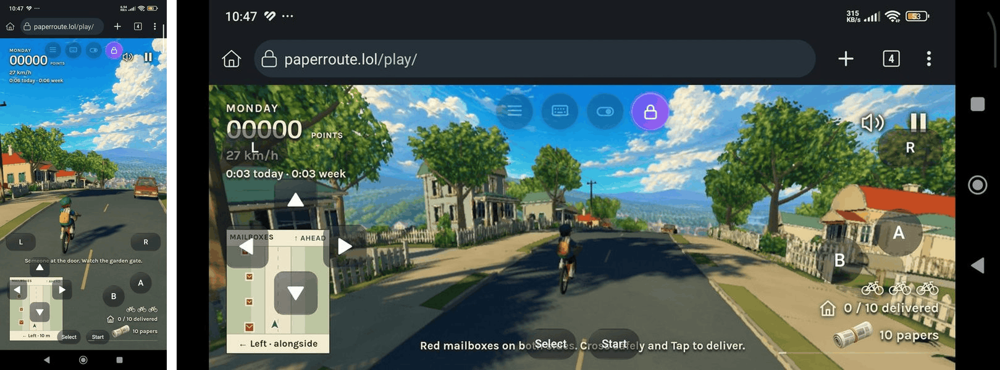

<h1 id="webtroller--on-screen-game-controller-for-any-website">WebTroller — On-Screen Game Controller for Any Website</h1>

<strong>Developed by Vertzz</strong> · Contact: <a href="https://t.me/vertzz_official">https://t.me/vertzz_official</a> · © 2026 Vertzz

WebTroller is a browser extension that puts a <strong>customizable game controller on top of any website</strong>. Its buttons send real key presses, mouse clicks, scrolls and mouse movement to the page, so you can play browser games and web emulators on a <strong>touch screen</strong> without a keyboard or mouse.

 

<h2 id="what-can-you-do-with-it">What can you do with it?</h2>

<ul>
<li>Play browser games and web emulators with touch buttons, D-pads and analog sticks.</li>
<li>Start from a ready-made controller (PlayStation, Xbox, Switch, SNES, Arcade and more) or build your own.</li>
<li>Move, resize, recolor and rename every button, and give it an icon.</li>
<li>Keep a separate layout for <strong>portrait</strong> and for <strong>landscape</strong>.</li>
<li>Put up to <strong>5 modes</strong> (different button sets) in one layout, for example Walking / Driving / Swimming, and switch between them while you play.</li>
<li>Use extra tools while playing: FPS and ping readouts, screen lock, fullscreen, brightness, opacity, volume, an on-screen keyboard and an ad blocker.</li>
</ul>

<h2 id="install">Install</h2>

<strong>Chrome, Edge, Brave (computer) or Kiwi Browser (Android)</strong>

<ol>
<li>Unzip the WebTroller zip.</li>
<li>Open <code>chrome://extensions</code> (Edge: <code>edge://extensions</code>).</li>
<li>Turn on <strong>Developer mode</strong>.</li>
<li>Click <strong>Load unpacked</strong> and choose the WebTroller folder.</li>
</ol>

<strong>Firefox 121 or newer (computer or Android)</strong>

<ol>
<li>Rename <code>manifest.json</code> to <code>manifest.chrome.json</code>.</li>
<li>Rename <code>manifest.firefox.json</code> to <code>manifest.json</code>.</li>
<li>Open <code>about:debugging#/runtime/this-firefox</code>, click <strong>Load Temporary Add-on</strong> and pick <code>manifest.json</code>.</li>
</ol>

<blockquote>

Firefox removes temporary add-ons when it closes. A permanent install needs a Mozilla-signed add-on.
Chrome on Android cannot run extensions. Use Kiwi Browser or Firefox.

</blockquote>

<h2 id="quick-start">Quick start</h2>

<ol>
<li>Open your game's website.</li>
<li>Click the <strong>WebTroller icon</strong> in the browser toolbar (or press <strong>Alt+Shift+E</strong>). The controller appears.</li>
<li>Tap the round <strong>☰</strong> button to open the menu.</li>
<li>Tap <strong>Controllers</strong> and pick one, or tap <strong>Edit Layout</strong> to build your own.</li>
<li><strong>Tap the game once</strong> so it has focus, then use the buttons.</li>
</ol>

WebTroller stays open on that tab through page reloads until you hide it (click the icon again or press Alt+Shift+E). Closing the tab forgets it.

<h2 id="the-menu">The menu</h2>

Tap <strong>☰</strong> to open the menu. Tap outside it to close it. The small <strong>ⓘ</strong> button at the top opens a short note on why WebTroller helps when your phone has no physical keyboard.

<table>
<thead>
<tr>
<th>Button</th>
<th>What it does</th>
</tr>
</thead>
<tbody>
<tr>
<td><strong>Edit Layout</strong></td>
<td>Design your own controller (see <a href="#edit-layout">Edit Layout</a>)</td>
</tr>
<tr>
<td><strong>Controllers</strong></td>
<td>Pick a ready-made controller (see <a href="#controllers">Controllers</a>)</td>
</tr>
<tr>
<td><strong>Load Layout</strong></td>
<td>Load or delete a layout you saved. Also has <strong>Restore Backup</strong></td>
</tr>
</tbody>
</table>

<strong>Tools</strong>

<table>
<thead>
<tr>
<th>Button</th>
<th>What it does</th>
</tr>
</thead>
<tbody>
<tr>
<td><strong>Performance</strong></td>
<td>Shows an FPS readout: FPS, frame time, 1% low, JS memory (where the browser supports it) and a graph</td>
</tr>
<tr>
<td><strong>Network</strong></td>
<td>Shows a connection readout: ping, jitter, packet loss and traffic (see <a href="#keyboard-network-and-ad-blocker-explained">below</a>)</td>
</tr>
<tr>
<td><strong>Modes</strong></td>
<td>Shows or hides the round <strong>Modes</strong> button used to switch modes while you play (on by default)</td>
</tr>
<tr>
<td><strong>Keyboard</strong></td>
<td>Adds a floating keyboard button and stops your phone's keyboard from popping up (see <a href="#keyboard-network-and-ad-blocker-explained">below</a>)</td>
</tr>
<tr>
<td><strong>Visibility</strong></td>
<td>Adds an eye button. Tap it to hide or show all controller buttons and the readouts. The Modes button stays visible</td>
</tr>
<tr>
<td><strong>Lock Screen</strong></td>
<td>Adds a lock button. Tap it to lock the page so accidental touches next to a button do not click or scroll the site. Controller buttons and the menu keep working</td>
</tr>
<tr>
<td><strong>Fullscreen</strong></td>
<td>Turns fullscreen on or off</td>
</tr>
<tr>
<td><strong>Ad Blocker</strong></td>
<td>Blocks ads and pop-ups (see <a href="#keyboard-network-and-ad-blocker-explained">below</a>)</td>
</tr>
</tbody>
</table>

<strong>Adjust</strong>

<table>
<thead>
<tr>
<th>Slider</th>
<th>What it does</th>
</tr>
</thead>
<tbody>
<tr>
<td><strong>Opacity</strong></td>
<td>Fades the controller buttons (100% down to 20%)</td>
</tr>
<tr>
<td><strong>Brightness</strong></td>
<td>Dims the page (100% down to 20%). Buttons are not affected</td>
</tr>
<tr>
<td><strong>Volume</strong></td>
<td>Turns the page's sound up or down (0–100%)</td>
</tr>
</tbody>
</table>

<strong>Buy Me A Coffee</strong> opens a small window with the developer's tip addresses (Bitcoin, Litecoin, Tron, Dogecoin, Bitcoin Cash and Pepe). Tap an address or its Copy button to copy it. WebTroller is free.

<strong>Floating buttons.</strong> The menu (☰), Visibility, Lock Screen, Keyboard and Modes buttons float on screen. Drag them anywhere. They fade a moment after you stop touching them. Pinch-zoom is blocked while WebTroller is showing, so touching the controller never zooms the game.

<h2 id="keyboard-network-and-ad-blocker-explained">Keyboard, Network and Ad Blocker explained</h2>

<h3 id="keyboard">Keyboard</h3>

Some games and sites need typing (a name, a chat message, a login). On a phone the normal keyboard covers half the screen. This switch fixes that.

<ul>
<li>Turn <strong>Keyboard</strong> on in the menu. A floating keyboard button appears.</li>
<li>While it is on, your phone's keyboard <strong>does not open</strong> when you tap a text field. Tap the floating keyboard button to open <strong>WebTroller's own keyboard</strong> instead. (Tap a text field on the page first.)</li>
<li>A text bar above the keys shows what you are typing.</li>
<li>The keys are: letters, numbers and symbols, Shift, arrow keys, space, Enter and backspace. Hold an arrow key to repeat it.</li>
<li><strong>Hold a key</strong> (like a, e or n) to get extra characters, slide onto one and let go.</li>
<li>The <strong>globe</strong> button changes the language: English, Español, Français, Deutsch, Português, Italiano, Türkçe, Русский, Українська, العربية and Ελληνικά.</li>
<li>The <strong>emoji</strong> button opens an emoji page (Recent, faces, hands and people, animals, food, activities, travel, objects, symbols).</li>
<li>In password fields an <strong>eye</strong> button lets you show or hide what you typed.</li>
<li>It also works for text fields inside embedded game frames.</li>
<li>Turn <strong>Keyboard</strong> off and your phone's normal keyboard works again.</li>
</ul>

<h3 id="network">Network</h3>

A see-through box showing how good your connection is while you play. Useful when a game lags and you want to know if it is your internet.

<ul>
<li><strong>Ping</strong> in ms, with a graph. Lower is better.</li>
<li><strong>Jitter</strong>: how much the ping jumps around. Lower is smoother.</li>
<li><strong>Packet loss</strong>: how much data gets lost.</li>
<li><strong>Page traffic</strong>: how much the page is downloading.</li>
<li><strong>Connection</strong>: the connection type and speed your browser reports (an estimate, not in every browser).</li>
<li>Drag it to move it and use the small grip at the bottom right to resize it. It stops running while hidden.</li>
</ul>

<h3 id="ad-blocker">Ad Blocker</h3>

One switch that removes ads and pop-ups so they do not cover your game or buttons.

<ul>
<li><strong>Blocks ad networks:</strong> requests to well-known ad companies are blocked, and leftover ad boxes are hidden (also inside frames).</li>
<li><strong>Stops pop-ups and pop-unders:</strong> windows that open without you tapping, or that go to a known ad network, are refused.</li>
<li><strong>AdGuard DNS is included.</strong> Turning Ad Blocker on turns it on too. WebTroller asks AdGuard DNS about the websites a page loads things from, and the ones AdGuard marks as ad or tracker sites get blocked. It learns more the longer you use it.</li>
<li><strong>Privacy:</strong> only website names (like <code>ads.example.com</code>) are sent to AdGuard, never page addresses, page content or what you type. AdGuard can see your IP address, like any DNS service. Keep Ad Blocker off if you do not want that.</li>
<li><strong>Reload the page</strong> after switching it. It only affects pages loaded afterwards.</li>
<li>It does not block ads that a site serves from its own domain, and the first request to a brand-new ad server may get through.</li>
</ul>

<h2 id="controllers">Controllers</h2>

<strong>Controllers</strong> replaces the buttons of the orientation you are in (portrait or landscape) with a ready-made set and sets the keys for you. You can still edit everything afterwards.

<strong>Default</strong> (an empty layout to build from scratch), PlayStation, PSP, PS Vita, Xbox, Nintendo Switch, SNES, NES, Game Boy / Color, Game Boy Advance, Nintendo DS, Nintendo 3DS, Nintendo 64, GameCube, Wii Classic, Sega Genesis, Sega Saturn, Master System, Dreamcast, TurboGrafx-16, Neo Geo, Arcade, Atari 2600, Steam Deck, PC (WASD + mouse), Racing, Platformer, Casual (one tap) and Navigation.

Choosing a controller <strong>removes all your modes</strong> and leaves one mode with the new controller's buttons. Undo and Redo only work inside one controller.

<h2 id="edit-layout">Edit Layout</h2>

Open <strong>☰ → Edit Layout</strong>. The first time, a short tutorial walks you through it. Tap <strong>Help</strong> in the editor bar to see it again. The small tab under the editor bar hides the bar so you can see the whole screen.

<h3 id="the-editor-bar">The editor bar</h3>

<table>
<thead>
<tr>
<th>Button</th>
<th>What it does</th>
</tr>
</thead>
<tbody>
<tr>
<td><strong>Undo / Redo</strong></td>
<td>Step back or forward through your changes (also Ctrl+Z / Ctrl+Y on a keyboard)</td>
</tr>
<tr>
<td><strong>Button</strong></td>
<td>Adds a new button</td>
</tr>
<tr>
<td><strong>Analog Stick</strong></td>
<td>Adds a new analog stick</td>
</tr>
<tr>
<td><strong>Multi-Select</strong></td>
<td>Tap several buttons, then move or resize them together. <strong>Select All</strong> appears while it is on</td>
</tr>
<tr>
<td><strong>Grid</strong></td>
<td>Shows a grid and snaps buttons to it while you drag</td>
</tr>
<tr>
<td><strong>Captions</strong></td>
<td>Turns the small captions under button labels on or off for the whole layout</td>
</tr>
<tr>
<td><strong>Borders</strong></td>
<td>Turns button borders on or off for the whole layout</td>
</tr>
<tr>
<td><strong>Save Layout</strong></td>
<td>Save the layout (see <a href="#saving-and-loading">Saving and loading</a>)</td>
</tr>
<tr>
<td><strong>Reset</strong></td>
<td>Goes back to the last controller you chose, for the mode you are on. It only asks to confirm when something would change</td>
</tr>
<tr>
<td><strong>Help</strong></td>
<td>Shows the tutorial</td>
</tr>
<tr>
<td><strong>Done</strong></td>
<td>Leaves the editor. It asks whether to <strong>Save</strong> or <strong>Discard</strong> your changes (✕ returns to the editor)</td>
</tr>
</tbody>
</table>

Drag a button to move it. Select it and drag its round handle to resize it.

<h3 id="button-properties">Button properties</h3>

Select a button and the <strong>Properties</strong> window opens.

<ul>
<li><strong>Name</strong>, <strong>Icon</strong>, <strong>Shape</strong> (Square, Wide, Circle, Oval), <strong>Color</strong> (swatches or a custom color) and <strong>Size</strong>. Borders and captions are turned on or off for the whole layout with the <strong>Borders</strong> and <strong>Captions</strong> buttons in the editor bar.</li>
<li><strong>Icon:</strong> pick from <strong>430 built-in icons</strong> in 12 groups (Arrows, Controller, Movement, Combat, Vehicle, Items, Media, Basketball, Ball Sports, Racket &amp; Paddle, Water &amp; Boat, Fitness &amp; Outdoor), or choose <strong>No Icon (Use Label)</strong> to show the button's name instead. Icons are vector (SVG), so they stay sharp at any size.</li>
<li><strong>This button presses:</strong> opens <strong>Choose Input</strong> (below).</li>
<li><strong>Duplicate</strong> and <strong>Delete</strong> are at the bottom.</li>
</ul>

<h3 id="choose-input">Choose Input</h3>

Pick what a button does. Tap <strong>None</strong> for no action.

<ul>
<li><strong>Keyboard tab:</strong> Letters, Numbers, Arrows and special keys (Space, Enter, Esc, Tab, Backspace, Shift, Ctrl, Alt, Del, Ins, Home, End, PgUp, PgDn) and F1–F12.</li>
<li><strong>Key combinations:</strong> tap <strong>Ctrl</strong>, <strong>Alt</strong>, <strong>Shift</strong> and/or <strong>Win / Cmd</strong> first, then pick the key (for example Ctrl + K or Ctrl + Alt + Del). <strong>Modifiers Only</strong> makes a button that only holds those modifiers. <strong>Press A Key…</strong> records a key or combination from a physical keyboard.</li>
<li><strong>Mouse tab:</strong> Left Click, Right Click, Middle Click, and Scroll Up / Down / Left / Right. Clicks and scrolls happen at the center of the screen, where the analog stick aims from.</li>
</ul>

<h3 id="analog-sticks">Analog sticks</h3>

Select a stick and choose what it moves:

<ul>
<li><strong>Mouse Look</strong></li>
<li><strong>W A S D</strong></li>
<li><strong>Arrows</strong></li>
<li><strong>Scroll</strong></li>
</ul>

A <strong>Speed</strong> slider sets how fast it moves.

<h3 id="hold-to-lock-a-button">Hold to lock a button</h3>

Turn on <strong>Hold 0.5 sec to lock the button</strong> in Properties.

<ul>
<li><strong>Normal button:</strong> touch and hold for half a second until a lock icon appears, then lift your finger. The button stays pressed. Touch it again to release it.</li>
<li><strong>Analog stick:</strong> push the stick toward a lock direction for half a second until the lock icon turns solid, then let go. The stick stays pushed that way (good for walking forward or driving). Touch it again to release it. <strong>Lock directions</strong> in Properties chooses which sides can lock (Up, Left, Right, Down).</li>
</ul>

Everything is released when you open the editor, hide the buttons, switch modes or change layout.

<h3 id="modes-several-button-sets-in-one-layout">Modes (several button sets in one layout)</h3>

One layout can hold up to <strong>5 modes</strong>, each a complete set of buttons. For example: one for walking, one for driving.

<strong>In the editor</strong>

<ul>
<li>A row under the editor bar shows one button per mode. Tap one to edit that mode.</li>
<li><strong>+</strong> adds a mode (a copy of the one you are on). <strong>Modes</strong> opens the Modes window.</li>
<li>Tap the current mode (or hold any mode) for a small menu to change its icon or delete it.</li>
<li>In the <strong>Modes window</strong> you can add an <strong>Empty Mode</strong> or a <strong>Copy This Mode</strong>, and for each mode: choose an icon (a number is shown until you pick one), rename it, move it up or down, delete it, or turn <strong>In switcher</strong> off. A mode with In switcher off is left out of the play list; at least one mode must stay in. You can also turn the round Modes button on or off here.</li>
<li>Nothing about the modes is saved until you tap the editor's <strong>Done</strong> and choose <strong>Save</strong>. That covers adding, deleting, renaming and moving a mode, changing its icon, and turning <strong>In switcher</strong> on or off, whether you do it in the Modes window or in the mode row. <strong>Done</strong> asks <strong>Save</strong> or <strong>Discard</strong>, and Discard puts back deleted modes, old names, the old order, the old icons and the old <strong>In switcher</strong> settings. Changes to the buttons still need <strong>Save</strong> too. The Modes window is closed with its <strong>✕</strong> button.</li>
<li>Switching mode (or adding a mode) never asks to save. All your changes, in every mode, wait until you tap the editor's <strong>Done</strong>, which asks <strong>Save</strong> or <strong>Discard</strong> once. <strong>Discard</strong> puts every mode back the way it was before you started.</li>
<li>Modes have no name by default: the name box is empty and shows the hint <strong>Mode Name</strong> until you type one. An empty name stays empty.</li>
<li><strong>Every mode has its own Undo and Redo.</strong> Switch to another mode and back and its history is still there, and undoing or redoing in one mode never changes the buttons of another. All history is cleared when you leave the layout editor (Done, with Save or Discard). The history of a deleted mode goes with it, and loading a layout or choosing a controller starts every mode's history over (those two steps can still be undone as a whole right after you do them).</li>
</ul>

<strong>While you play</strong>

<ul>
<li>Tap the round <strong>Modes</strong> button to open the list, then tap a mode.</li>
<li>Or <strong>hold the button for about a third of a second and slide</strong> to a mode, then lift your finger to pick it. Lift off the list to cancel.</li>
<li>The list opens toward the middle of the screen. The button briefly shows the icon of the mode you picked.</li>
<li>Switching modes releases every key, mouse button and locked control first, so nothing gets stuck.</li>
</ul>

<h3 id="portrait-and-landscape">Portrait and landscape</h3>

Each orientation has its own layout and its own saved list. Rotate your device and WebTroller loads the matching one. The editor bar shows which one you are editing.

<h3 id="saving-and-loading">Saving and loading</h3>

<ul>
<li><strong>Save Layout</strong> (in the editor) saves the layout under a name. It will not overwrite an existing name (it shows &quot;already exists&quot;). Use <strong>Save As</strong> on a saved layout to replace it with what you are editing.</li>
<li><strong>Also save this page's address (URL):</strong> stores the current page with the layout. In <strong>Load Layout</strong>, that layout gets an <strong>Open Page</strong> button that loads the layout and opens the page. <strong>Load</strong> alone only loads the layout.</li>
<li><strong>Load Layout</strong> (in the menu) lists the layouts saved for the orientation you are in. You can load or delete them.</li>
<li><strong>Download Backup</strong> (in Save Layout) saves all your layouts to one file. <strong>Restore Backup</strong> (in Load Layout) brings them back.</li>
<li>Layouts remember the screen size they were made on. If you load one on a <strong>smaller screen</strong>, an alert warns that buttons may be cramped or overlap. You can fix them in Edit Layout.</li>
</ul>

<h2 id="tips">Tips</h2>

<ul>
<li><strong>Click the game once</strong> before using the controller, so the game has focus. Games inside an embedded frame (iframe) are supported.</li>
<li>Use <strong>Lock Screen</strong> if your fingers sometimes touch the game by accident.</li>
<li>Use <strong>Hold to lock</strong> for actions you need held down, such as running or accelerating.</li>
<li>If a page removes WebTroller, it puts itself back. When a page goes fullscreen, WebTroller moves into it.</li>
</ul>

<h2 id="limits">Limits</h2>

<ul>
<li>Some games ignore scripted input because they check that events come from a real device. No on-screen controller can control those.</li>
<li>If the fullscreen element is a bare video, canvas or frame, WebTroller cannot be shown inside it.</li>
<li><strong>Volume</strong> only changes sound that goes through the page's own audio (HTML audio and video, and Web Audio, which most games use). Sound from plugins or other apps is not affected. It only works on pages loaded after the extension was installed or reloaded.</li>
<li><strong>Network</strong> ping is an estimate, and &quot;Page traffic&quot; can read lower than your real use.</li>
<li><strong>Ad Blocker</strong> only affects pages loaded after you switch it.</li>
<li>WebTroller asks for access to all sites so it can send input to the game. It only runs on a tab after you open it there.</li>
</ul>

<h2 id="files">Files</h2>

<table>
<thead>
<tr>
<th>File</th>
<th>Purpose</th>
</tr>
</thead>
<tbody>
<tr>
<td><code>manifest.json</code>, <code>manifest.firefox.json</code></td>
<td>Extension manifests (Chrome-based browsers, Firefox)</td>
</tr>
<tr>
<td><code>background.js</code></td>
<td>Opens WebTroller, keeps it open per tab, passes input to game frames, switches the ad block list and asks AdGuard DNS about new website names</td>
</tr>
<tr>
<td><code>frame.js</code></td>
<td>Plays forwarded input inside embedded game frames, hides leftover ad boxes, and types into text fields inside frames</td>
</tr>
<tr>
<td><code>volume.js</code></td>
<td>Scales the page's sound for the Volume slider</td>
</tr>
<tr>
<td><code>adblock.js</code></td>
<td>Refuses pop-ups and pop-unders</td>
</tr>
<tr>
<td><code>rules/ads.json</code></td>
<td>The ad network block list used by the Ad Blocker</td>
</tr>
<tr>
<td><code>content.js</code></td>
<td>The overlay itself (generated by <code>build.py</code>)</td>
</tr>
<tr>
<td><code>src/</code></td>
<td>Readable source code: <code>style.css</code>, <code>body.html</code> and the numbered <code>*.js</code> parts</td>
</tr>
<tr>
<td><code>build.py</code></td>
<td>Rebuilds <code>content.js</code> from <code>src/</code> (run <code>python3 build.py</code>)</td>
</tr>
<tr>
<td><code>icons/</code></td>
<td>Extension icons</td>
</tr>
</tbody>
</table>

<h2 id="about">About</h2>

WebTroller is developed by <strong>Vertzz</strong>. For questions, support or business contact: <a href="https://t.me/vertzz_official">https://t.me/vertzz_official</a>

